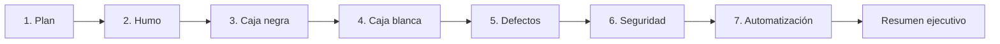
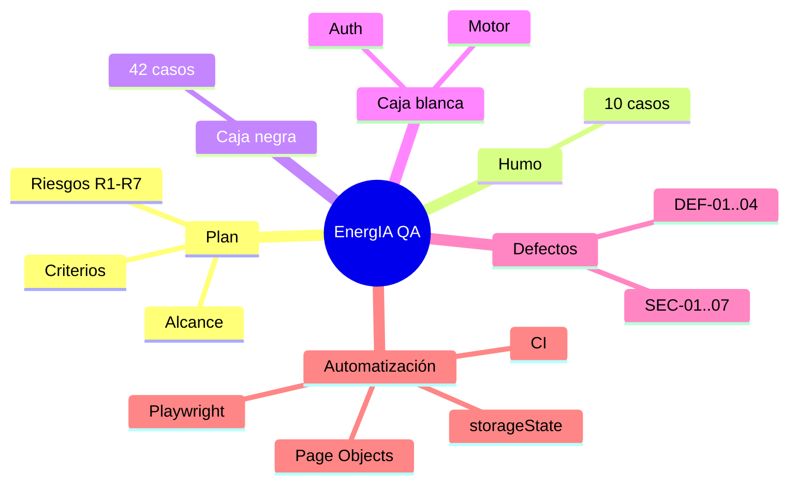

# Mapa de la prueba (MOC)

> [!note] MOC = Map of Content
> Esta nota es el **panel central** del vault. Desde aquí se llega a todo.

## Fases

## Notas por fase
- [[01-Plan/Plan de pruebas]]
- [[02-Humo/Suite de humo]]
- [[03-Caja-Negra/Casos de caja negra]]
- [[04-Caja-Blanca/Caja blanca]]
- [[05-Defectos/Registro de defectos]]
- [[06-Seguridad/Reporte de seguridad]]
- [[07-Automatizacion/Playwright E2E]]
- [[08-Evidencias/Índice de evidencias]]
- [[90-Meta/Bitácora de trabajo]]

## Cómo navegar
- Usa **Ctrl+O** para abrir una nota por nombre.
- El **grafo** (Ctrl+G) muestra los enlaces entre notas.
- Haz clic en los `[[wikilinks]]` para saltar.

#energia #qa #moc
